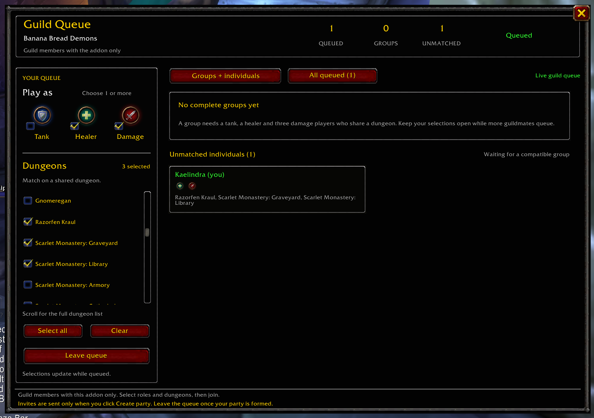

# Guild Queue — WoW:Forever addon

**Version 0.4.0 — draft; native styling and role icons still need in-client visual verification.** Targets Forever interface `16001` (1.60.1). No external addon libraries or server are required.

## Screenshot

## What it does

- Select any combination of **Tank**, **Healer**, and **Damage** using WoW's native shield, healing-cross, and damage role icons with checkbox overlays.
- Select one or more dungeons, including Forever's nine new dungeons.
- Join a shared queue visible to guild members running the same addon version.
- Suggest five-player groups: **one tank, one healer, three damage dealers**. Each player fills exactly one of their selected roles, and all five must share at least one selected dungeon.
- Display **native WoW styling**: dialog borders, dark panels, gold headings, standard panel buttons, checkboxes, close-button artwork, and scroll knobs. Keep queue counters and scrollable selections.
- Highlight **your suggested group** with five player tiles showing their **assigned-role icons**. Show other groups, **unmatched individual cards**, and an **all queued members** tab. Individual cards show an icon for each selected role; your group's tiles also show selected-role icons below the name. Each player appears in at most one suggestion.
- Show full character names, roles, and dungeon selections in hover tooltips while keeping card text bounded.
- Show **Create party** on your own suggested group. Clicking it requests invitations for the other four players; each must accept through WoW.
- Disable **Create party** while you are already in a party or raid. Hovering the disabled button explains: **"You are already in a party or raid. Leave your current group to create a new party."** The button updates as you join or leave a group.
- **Never send invitations automatically, accept invitations, or teleport players.**

These are live suggestions, not reserved or confirmed groups. Invitations happen only on an explicit button click, never from matchmaking, messages, or timers. The action also checks the current suggestion and group membership immediately before requesting invitations. Combat, stale suggestions, and a five-second repeat-click cooldown also disable the action with explanatory tooltips. Failed invitations are not retried automatically; WoW may reject requests if someone is offline, grouped, or otherwise ineligible.

Players explicitly leave the queue when no longer looking. Requesting invitations or joining a real party does not automatically remove an entry.

## Install

1. Close the game client.
2. Extract the download and copy its **`GuildQueue` folder** into your Forever installation's `Interface/AddOns` directory. The resulting file must be `Interface/AddOns/GuildQueue/GuildQueue.toc`.
3. Start Forever and enable **Guild Queue** in the AddOns list.
4. Have participating guild members install the same version.
5. Type **`/gq`** (or `/guildqueue`). Select roles and dungeons, then click **Join queue**.
6. When a suggested group includes you, click **Create party** to invite the others, provided you are not already grouped. Leave the queue once you have formed your party.

Additional commands: `/gq join` uses your current selections; `/gq leave` withdraws; `/gq status` explains readiness and reports whether guild membership, guild information, character information, and addon messaging are available. Hovering **Join queue** explains why it is disabled. Role and dungeon selections are saved per character. Active queue membership is **not** saved: after login or `/reload`, explicitly join again. Clearing the last selected role or dungeon while queued withdraws you.

Use Battle.net's **Show in Explorer** to find your installation; the launch client's folder is normally `_forever_`. Other files in this download are development files and do not need to be installed.

**Updating from 0.2.x or 0.3.x:** close WoW, copy this download's `GuildQueue` folder over the installed folder, then restart WoW. Your saved role/dungeon preferences are preserved; explicitly join the queue again after login.

**UI update in 0.4.0:** native WoW dialog borders and panel-button/checkbox/close-button templates replace the navy/gold custom skin. The role selector uses 48-pixel native LFG role icons with checkbox overlays and remains multi-select. Group slots show assigned-role icons; individual and all-queued cards show every selected role as an icon. Role names remain in labels/tooltips. Pooled cards reset their icons when preferences change so old selections do not remain visible. Cards, counters, per-tab scrolling, and click-only invitations are retained. No external artwork or Blizzard Dungeon Finder queue integration is required. Actual font rendering and asset appearance still need verification in WoW.

**Duplicate-entry fix in 0.3.0:** character/realm names are normalized consistently when the client supplies a space or hyphen separator. Already-qualified local names no longer get their realm appended twice, and your own echoed guild messages are ignored. Same-named characters from different realms remain distinct.

**Startup fix in 0.2.1:** the addon no longer waits for your character to appear in a separate guild-roster cache before enabling the queue. Guild and character information are retried automatically. If a genuine prerequisite remains unavailable, hover **Join queue** or use `/gq status` to see the reason.

## How synchronization and matching work

Each queued player broadcasts only their own state on the **guild addon-message channel**, initially and every 20 seconds. Newly connected addon users request current states. Withdrawals are sent immediately when possible; disconnected or unreachable entries expire after **75 seconds** without a fresh update. A small persisted revision counter prevents older messages from undoing newer updates or withdrawals.

Messages are accepted only through WoW's server-enforced **GUILD addon-message channel**, with the exact prefix, protocol version, and valid role/dungeon selections. The game-provided sender owns each entry; messages never relay someone else's state. WoW restricts delivery on this channel to guild members, so a separate cached roster is not needed for joining, synchronization, or matching. Whispers, party/raid channels, and ordinary chat are never used as fallbacks. Account restrictions, server throttling, combat/chat restrictions, or loading screens can delay delivery; the UI reports send failures and retries.

Guild identity is checked before accepting messages, and changing guilds clears the previous guild's queue data. If someone's guild membership ends or they disconnect, their last advertised entry may remain until its 75-second lease expires.

Every client independently computes the same result **when it has the same live queue data**. Brief differences between clients are possible while messages arrive or entries expire. There is no central server, guild officer host, or reservation/confirmation mechanism.

Matching prioritizes older feasible candidates, breaks equal-age ties by full character name, and handles multi-role reassignment. It is not a global optimizer for the maximum possible number of groups across all dungeon combinations. Suggestions may change as the queue changes.

Dungeon selections are preferences, **not eligibility checks**: this version does not validate level, quests, keys, attunements, lockouts, travel, or class suitability for a selected role. The catalog uses permanent addon-local IDs, not Blizzard activity IDs. Larger-party activities are outside this five-player matcher.

## Validation

Automated Lua tests are included in `tests/run.lua`, covering protocol validation, out-of-order messages, withdrawal tombstones, expiry, role assignment, shared dungeon constraints, deterministic matching, simulated client synchronization, UI control interactions, click-only party invitations, already-grouped tooltips, stale suggestions, combat restrictions, and repeat-click protection. A generated-queue test compares matching feasibility with a brute-force reference.

Run from the extracted project root with **Lua 5.1**: `lua5.1 tests/run.lua` (or `lua tests/run.lua` if that is your Lua 5.1 executable). Lua is a development tool only and is not required by players.

**Current status:** all **66 automated tests passed** under **Lua 5.1.5**, including the 200 generated-queue feasibility comparisons, click-only invitation requests, already-grouped disabled-button tooltips, and simulated UI interactions. Regression coverage verifies queuing/matching with an empty roster or no legacy roster APIs, guild-only message filtering, delayed identity recovery, clearing old data on guild changes, explanatory Join queue tooltips, self-message deduplication, and distinct same-named characters on different realms. UI checks cover native frame/button/checkbox templates, opaque panel fills, five-member tiles, card reuse, scrolling/clamping, and label bounds. New tests verify multi-select role icons, assigned versus selected-role icons, clearing stale icons on pooled individual/all-queued cards, icon bounds, and pressed-state native tabs. Static source/package checks also passed. Tests use simulated WoW APIs: they are not a substitute for visual and live multi-player testing inside WoW.

Before wider use, test with at least five addon-equipped guild characters:

1. Create a compatible tank/healer/three-damage selection and verify a common-dungeon group appears on all clients.
2. Select multiple roles and overlapping/disjoint dungeons; verify nobody is duplicated and incompatible selections remain unmatched.
3. Join before opening the Guild window and verify that no roster-cache wait blocks you. Your own guild-message echo must not add a second entry or rejoin you after withdrawal. With a late-loading client, change preferences, leave, `/reload`, and disconnect; verify synchronization and expiry.
4. Verify that matching and queue updates never issue invitations. Click **Create party** while solo and verify that exactly the other four players receive invitations and must accept manually.
5. Join a party or raid and verify that **Create party** is disabled and its tooltip explains why. Leave the party and verify that the button becomes available again. Also test stale suggestions, combat, declined invitations, and players disconnecting during the action.
6. Test messaging during combat/loading and any account restrictions, plus guild departure/rejoining and alongside other addons.
7. Verify native borders/buttons/checkboxes, role selector icons and checkmarks, card text and role icons, hovered full-name/dungeon tooltips, both tabs, mouse-wheel/track scrolling, and small-screen scaling. Change selected roles while queued and confirm icons update without stale selections. Confirm that queued/group/unmatched counters reflect actual unique players.

## Source layout

- `Catalog.lua`: stable dungeon catalog and role constants.
- `Protocol.lua`: compact, validated guild messages.
- `State.lua`: live queue, revision ordering, withdrawals, expiry.
- `Matcher.lua`: deterministic role-compatible group suggestions.
- `UI.lua`: native WoW styling/controls and role icons, pooled group/member/individual cards, counters, tooltips, and scrollable selections/views.
- `Core.lua`: client events, guild identity and guild-channel validation, throttled synchronization, guarded click-only invitation requests, and diagnostic commands.

## Compatibility references

- [Blizzard's Forever dungeon announcement](https://news.blizzard.com/en-us/article/24301455/explore-the-new-dungeons-of-world-of-warcraft-forever)
- [Forever client API declarations](https://github.com/Gethe/wow-ui-source/blob/forever/Interface/AddOns/Blizzard_APIDocumentationGenerated/ChatInfoDocumentation.lua)
- [Addon message API and limits](https://warcraft.wiki.gg/wiki/API:C_ChatInfo.SendAddonMessage)
- [Party invitation API](https://warcraft.wiki.gg/wiki/API:C_PartyInfo.InviteUnit)
- [Forever native LFG role UI](https://github.com/Gethe/wow-ui-source/blob/forever/Interface/AddOns/Blizzard_LFGUtil/Shared/LFGRole.xml)
- [Forever native panel-button/close-button templates](https://github.com/Gethe/wow-ui-source/blob/forever/Interface/AddOns/Blizzard_SharedXML/Mainline/SharedUIPanelTemplates.xml)
- [Forever client development notes and interface version](https://github.com/Tautellini/TautelliniAddons/blob/main/docs/forever-addon-development.md)
