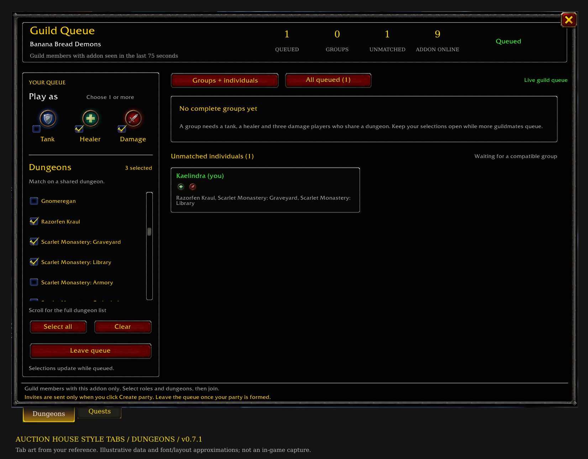

# Guild Queue — WoW:Forever addon

**Version 0.17.2 — clearer WoW-managed party role messaging; needs in-client visual and multiplayer confirmation.** Targets Forever interface `16001` (1.60.1). No external addon libraries or server are required.

## Screenshot

The screenshot shows an earlier native-UI build. The current window has **Dungeons** and **Quests** bottom tabs. Dungeons also has a **Default / Role List** view selector.

### Earlier bottom-tab previews (0.7.1)

These are older design mockups, not in-game captures. They do not show the 0.7.2 spacing fix or the uniform tab geometry introduced in 0.7.3. The tabs use blank art strips from your Auction House reference: a gold-bordered selected tab and darker inactive tabs, hanging beneath the frame. Fonts and layout are approximate; the addon itself uses WoW's built-in tab artwork, not these preview images.

## What it does

- **Left-click the minimap icon** to show or hide Guild Queue. **Left-drag** it around the minimap to reposition it; the position is saved per character. Dragging does not toggle the window. `/gq` remains available.
- Discover **newer stable versions reported by guildmates**, with a quiet gold notice in every window view and details in the minimap tooltip. Click the notice for a copyable, fixed project link and manual installation instructions. There are no automatic popups, web requests, downloads or installations.
- While solo, select any combination of **Tank**, **Healer**, and **Damage** that Forever recommends for your class, using native role icons with checkbox overlays. Unsupported roles are disabled with hover explanations. In a party, this selector is replaced by **Party roles** messaging: set each member's role in WoW's party controls; Guild Queue uses those assignments automatically. The normal role icons and saved selections return when solo.
- Select one or more dungeons, including Forever's nine new dungeons. Names show **recommended LFG level ranges in parentheses**, such as **Ragefire Chasm (13-18)**. These are recommendations, not minimum entry restrictions; all dungeons remain selectable.
- Join a shared queue visible to guild members running the same addon version. **Only the native party leader can queue an existing party.** The leader must be in the guild, but their party members need neither guild membership nor the addon. The whole party uses its already-assigned WoW roles and the leader's selected dungeons; non-leaders cannot queue individually.
- Suggest **complete and partial groups of 2–5 compatible players**, working toward **one tank, one healer, three damage dealers**. Solo players fill one of their offered roles; existing party members retain their native assigned role and stay together as one unit. A suggestion contains at most one existing party plus compatible solo recruits, never a merger of native parties. Everyone shares a selected dungeon. Complete groups take priority, followed by the largest compatible partial matches.
- Display **native WoW styling**: dialog borders, dark panels, gold headings, standard panel buttons, checkboxes, close-button artwork, and scroll knobs. Show queue counters, a live count of recently heard-from guild members with the addon, and scrollable selections.
- Highlight **your suggested group** with five role tiles showing assigned players or **Needed** placeholders. A **2 / 5 matched** card can start a party without waiting for all five players. Show other groups, **unmatched individual cards**, and an **all queued members** view within Dungeons. Individual cards show an icon for each selected role; your group's tiles also show selected-role icons below the name. Each player appears in at most one suggestion.
- Switch between **Default** (the existing initial view) and **Role List**. Role List shows **Tank**, **Healer**, and **Damage** columns of offered roles, longest waiting first, with full-name tie breaks. While solo, players need a dungeon overlapping your selections. With a queued normal party, recruits must share the leader's selected dungeons and their column's role must fit alongside the party's **native assigned roles** into one Tank, one Healer and three Damage slots. Multiple solo offered roles are not confirmed assignments.
- Each Role List card shows queue duration, shared dungeons and **Invite as Tank/Healer/Damage**. Existing members show disabled **In party**; your character shows **You**. Browse while solo without queueing yourself. A queued party's members do not need independent queue entries or preferences; the leader advertises the whole unit. Legacy unqueued-party browsing still requires fresh member preferences and a shared-dungeon intersection, otherwise it explains the unavailable data instead of guessing. Members of another queued party cannot be invited individually. Default's existing filters are unchanged.
- Clicking a role-specific invite queues a short-lived, guild-only role notice for updated clients. The recipient sees the requested role and is told to confirm it with the inviter. **A request is not agreement**, does not assign a native role and never accepts the party invitation. Older addons ignore the notice but still receive the normal WoW invitation; coordinate roles manually.
- Show full character names, roles, and dungeon selections in hover tooltips while keeping card text bounded.
- Switch between the **Dungeons** and **Quests** bottom tabs. Dungeons contains queue selections and the **Default** / **Role List** switches. The **Groups + individuals** / **All queued** navigation buttons are hidden by default and can be restored in `GuildQueue/Config.lua`; Quests hides those controls and uses the full content area for online guildmates in your zone, their levels, and shared active quests. Expand a member's card to compare your completion status with theirs.
- Show an **Invite** button on every same-zone member card, including members without the addon or shared quests. A click requests a native WoW invitation for that person only; they must accept. Buttons explain combat, full-group, permission, unavailable-roster and short repeat-click restrictions on hover.
- **Quest sharing is off by default.** Only consenting addon users send their zone ID, level, active quest IDs and completion flags. Guild-roster zones can still show members without the addon; unavailable quest data is never reported as zero shared quests.
- Show **Create party** on your own complete or partial match while solo. Clicking it requests invitations for **only the other matched players** (one to four); each must accept through WoW. Empty role slots never generate invitation requests.
- Change that action to **Invite Others** when your existing normal party consists entirely of members of your current suggested group. Clicking invites **only the suggested members not already in your party**, never yourself or existing party members. You need invitation permission, free capacity and at least one missing suggested member. Unrelated parties, raids, instance groups and unavailable/restricted roster data remain blocked. The label, enabled state and tooltip update as party membership changes.
- Broadcast **Forming...** before inviting from your current matchup. Other updated clients temporarily disable competing **Create party / Invite Others** and individual invitations involving those matched players, with the inviter and remaining time in tooltips. Other matchups remain available.
- **Never send invitations automatically, accept invitations, or teleport players.**

These are live suggestions, not reserved or confirmed groups. Invitations happen only on an explicit button click, never from matchmaking, messages, or timers. The **Create party / Invite Others** action checks the current suggestion and live party membership immediately before requesting invitations. Existing-party eligibility requires every party member to belong to that same current suggestion; one overlapping member does not authorize inviting into an otherwise unrelated party. The action also checks invitation permission/capacity for existing parties, skips existing members, and is disabled when all suggested members have joined. Batch requests share member cooldowns with individual invites. **Role List Invite** clicks refresh guild identity and recheck the live party roster, target's fresh queue entry, whole-party shared dungeons, selected role and role capacity, native invitation permission and group capacity. Existing members are never reinvited. A complete match, shared quests and the same zone are not required. **Quests Invite** clicks refresh guild identity and the cached roster and additionally confirm that the person is online in your current zone. Both individual-invite views share a per-person five-second cooldown, including different role-column copies of the same player. They work while solo or in an existing group when WoW permits inviting; instance groups are excluded. Combat, stale suggestions, and a five-second repeat-click cooldown also disable the action with explanatory tooltips. Failed invitations are not retried automatically; WoW may reject requests if someone is offline, grouped, or otherwise ineligible.

**Temporary forming broadcasts:** a click announces a 10-second, guild-only invitation window before requesting native invitations. The announcing player can continue explicitly inviting under the normal native permissions and cooldowns; reusing that active window does not extend it. All-failed new attempts and queue withdrawal schedule a release; partial successes keep the window for outstanding invitations. Changed matchups, guild changes and expiry invalidate obsolete locks. A new successful attempt explicitly identifies its own retired predecessor, so a delayed release cannot clear it. If a required announcement cannot be submitted, no invitations are requested: wait and click again yourself. No timer or received message sends native invitations. This coordinates addon buttons, not native party leadership or WoW's own UI. It requires updated clients with the same current matchup; older versions ignore the optional messages, and clicks made before either announcement arrives can still race. WoW remains responsible for invitation acceptance and leadership.

Leave the queue when finished looking. Invitation requests alone do not enroll anyone or accept invitations. **Joining a native party withdraws a solo queue; the leader must explicitly click Queue party to recruit for that party.** An already-queued leader's **membership, assigned-role and dungeon changes update the listing automatically**, preserving queue age. Missing/unassigned roles, invalid role capacity or temporarily unavailable roster data hide the unusable listing while keeping the leader's queue intent; it republishes automatically once valid. Explicit leave, disbanding, losing leadership, raids/instance groups or clearing dungeon selections still stop the queue. An already-authorized click's invitation batch can finish an expected solo-to-party transition, then withdraws the old solo entry. Only an already-queued leader's roster changes automatically include new native party members; initially grouping as a solo player still requires an explicit party-queue click.

## Install

[Download GuildQueue-0.17.2.zip](GuildQueue-0.17.2.zip) and extract the `GuildQueue` folder.

1. Close the game client.
2. Extract the download and copy its **`GuildQueue` folder** into your Forever installation's `Interface/AddOns` directory. The resulting file must be `Interface/AddOns/GuildQueue/GuildQueue.toc`.
3. Start Forever and enable **Guild Queue** in the AddOns list.
4. Have participating guild members install the same version.
5. Left-click the **Guild Queue minimap icon**, or type **`/gq`** (or `/guildqueue`). Left-drag the icon to move it around the minimap. On **Dungeons**, solo players select roles/dungeons and click **Join queue**. For an existing party, assign everyone's roles in WoW first; its guild-member leader chooses dungeons and clicks **Queue party**. Other members need neither this addon nor guild membership and cannot queue independently.
6. In **Default**, click **Create party** on your own solo suggestion. For a queued native party, only its leader can use **Invite Others** to invite missing solo recruits. Alternatively use **Role List** for compatible individual recruits. Recipients must accept manually. Once the leader has queued the party, accepted recruits and other roster/assigned-role changes automatically update that listing; no repeat queue click is needed. Leave the queue when finished.
7. For questing, open the **Quests** bottom tab. Optionally enable **Share my active quests with my guild** so guildmates can compare against your quest log. Viewing other members' shared data does not require sharing your own. Click a member's **Invite** button to request a party invitation; this does not require quest sharing or the addon on their side.

Additional commands: `/gq join` queues your solo selections or, as native leader, your whole party using assigned roles and your dungeon selections; `/gq leave` withdraws your owned solo/party entry; `/gq status` explains readiness and reports whether guild membership, guild information, character information, and addon messaging are available. Hovering **Join queue** explains why it is disabled. Role selections, dungeon selections and the minimap icon position are saved per character. Changing valid queued selections immediately invalidates the old local suggestion while preserving queue age and queue intent. The latest update stays pending through chat lockdown or send failures, retrying with backoff; intermediate selections are coalesced, never replayed. **Waiting to broadcast** means no current local advertisement is confirmed. Leaving overrides a pending join/update. Other clients can retain the old advertisement until delivery or its 75-second expiry. Active queue membership is **not** saved: after login or `/reload`, explicitly join again. Clearing the last selected solo role or selected dungeon while queued withdraws your entry. Party queues use native assigned roles, not saved solo role selections.

Use Battle.net's **Show in Explorer** to find your installation; the launch client's folder is normally `_forever_`. Other files in this download are development files and do not need to be installed.

**Updating from an earlier version:** close WoW, copy this download's `GuildQueue` folder over the installed folder, then restart WoW. Your saved role/dungeon preferences are preserved; explicitly join the queue again after login.

**Party role messaging in 0.17.2:** replaces Play as, Choose 1 or more and the addon role selectors with a **Party roles** heading and explanation when native party roles apply, before and during queueing (including paused updates and non-leaders). It directs players to WoW's party controls and explains automatic use of those assignments. Returning to solo restores the original multi-select controls and saved choices. The message uses the existing role area's bounds; dungeon controls, queue permissions, party roles and synchronization are unchanged. Hidden role controls clear their owned tooltip.

**Automatic party listing updates in 0.17.1:** an already-queued leader's role and roster changes invalidate the old local suggestion immediately and publish a new whole-party snapshot, preserving queue age and coalescing changes during failed or incomplete sends. New members can be outside the guild and need no addon. Unassigned roles, invalid role capacity, offline members or temporarily incomplete roster/leadership information pause publication and send one withdrawal; the queue intent remains, with an explanatory hover message, and resumes when valid. Presence, quest sharing and version messages continue while paused. Explicit leave, disbanding or actual leadership loss cancel the queue and prevent automatic recovery. Initial solo-to-party grouping still requires a separate Queue party click. The party wire format is unchanged; v0.17.0 observers can receive these updates.

**Whole-party queue in 0.17.0:** native leaders can advertise their 2–5 player party to their own guild, including non-guild/non-addon members. All native roles, including the leader's, must be assigned and fit one Tank, one Healer and three Damage slots. The leader chooses dungeons; saved solo roles are preserved. Non-leaders are blocked through buttons, slash commands and queue APIs, and an old solo queue is withdrawn upon grouping. Multipart advertisements commit atomically, keep parties together in matching, and share the existing throttled scheduler/retries/75-second expiry. Only the existing party's leader recruits for its match; no automatic invitations or group changes. **Guild observers/leaders and addon-using party members need v0.17.0+ for these rules.** Older versions ignore party roster packets and do not enforce the new local leader-only policy; party members without any addon need not install it.

**Simpler dungeon controls in 0.16.6:** removes the Select all button and its bulk-selection callback. Choose dungeons using their individual checkboxes; Join queue and its hint move up into the vacated row. Leaving the queue still preserves your role and dungeon selections. Queue-view configuration, matching, messaging and click-only invitations are unchanged.

**Configurable queue-view buttons in 0.16.5:** adds `GuildQueue/Config.lua`, loaded before the UI. Its `showQueueViewButtons` flag defaults to `false`, hiding **Groups + individuals** and **All queued** while preserving their controls, callbacks and view/rendering code. Default still shows group suggestions and unmatched individuals; Default/Role List switches and Dungeons/Quests bottom tabs remain available. Set the flag to `true` and `/reload` to restore the two buttons in Default; they remain hidden in Role List and Quests, as before. The flag controls visibility only and does not alter matching, queue state, saved character preferences, messaging or invitations.

**Button sizing in 0.16.4:** Select all now matches Join queue's 34-unit height, keeping its position, width and selection behavior unchanged.

**Native dungeon row layout in 0.16.3:** uses Forever's Mainline-family LFG dimensions: **22-unit rows**, **30×30 checkboxes**, four-unit list padding, and the game's native LFG font objects for both font size and difficulty color. These are UI units; existing whole-window screen fitting still applies. Checkbox artwork uses the native additive hover highlight, and hovering the name/range area highlights its checkbox too. Highlights clear on leaving, scrolling, switching views, hiding the window or hovering another control. Dungeon names are single-line and left-aligned; level ranges occupy a separate 60-unit right-aligned column. Long names stay bounded rather than overlap the range, and full names/ranges remain in hover tooltips. Clicking either the checkbox or its name/range target performs exactly one normal selection change. Scroll height/padding account for the larger checkbox extending above and below its row, keeping the first and last checkboxes reachable. Role selectors, quest sharing controls, matching, queue synchronization and click-only invitation behavior are unchanged.

**Native dungeon list colors in 0.16.2:** dungeon names and their displayed ranges now use Forever's native LFG range logic: **orange** when your level is below the suggested minimum, **yellow** from the minimum through the maximum inclusive, and **grey** above the maximum. Colors are copied from the game's `LFGActivityEntry`, `LFGActivityEntryDifficult` and `LFGActivityEntryTrivial` fonts without changing our label sizes or wrapping. The list updates through the existing refresh cycle after leveling, and hover/click/selection refreshes preserve the colors. Missing or restricted level data displays neutral white until it becomes available. These are visual recommendations only: no dungeon is hidden, disabled or deselected, and matching, messaging, invitations and eligibility rules are unchanged.

**Relayed version reports in 0.16.1:** clients now advertise the highest version they know about, even when they have not installed it. For example, B running `0.18.0` and remembering a `0.21.0` report can tell A running `0.20.0` about `0.21.0`, even after the original reporter logs out. This never changes the installed-version label. Pending replies compare against the highest known version, so a lower report cannot suppress a higher cached report. There is no immediate rebroadcast just for learning a newer version, and no periodic version heartbeat. Reports may be indirect and remain unverified; the UI says they may be relayed. Relaying requires v0.16.1+, but v0.16.0 can receive these reports because the wire format is unchanged.

**Guildmate version discovery (added in 0.16.0, updated in 0.16.1):** sends one optional, hidden `V` advertisement after login/guild identity is ready, using the highest of your installed stable version and any newer guildmate report. There is no separate request. Only clients with a higher known version schedule a reply to a lower announcement, with a random 2–5-second delay and at least 30 seconds between successful version sends, including after guild changes or identity recovery. Queue/quest traffic retains priority, and messaging failures use the existing retry backoff. Hearing an equal-or-higher known version cancels a pending reply. Clients validate canonical numeric `X.Y.Z` versions, timestamps, prefix and GUILD transport. Missing/prerelease/malformed installed metadata disables discovery rather than guessing. The highest newer report is retained only for the current guild/session and appears as **Newer version detected**, not a verified official release. The gold notice opens a reusable manual-copy dialog containing only the fixed project URL, and the minimap tooltip also updates while the main window is unopened or hidden. No queue, quest-sharing, matchmaking or invitation actions are triggered. **Clients older than v0.16.0 need a first manual upgrade to gain this checker.** If no online guildmate knows about a newer version, the addon cannot discover it. Numeric release comparison is separate from queue protocol compatibility; base queue/presence/quest formats are unchanged.

**Minimap launcher in 0.15.0:** adds a native minimap button with built-in group artwork and a hover tooltip explaining its controls. Left-click toggles the same window as `/gq`, even before joining a guild or queue. Left-drag moves the icon around the minimap and saves its angle in per-character preferences; movement accounts for minimap scale and size. Releasing a drag never counts as a toggle. The launcher is created once at login without opening the main window, and uses no per-frame updates while idle. No Questie installation, external libraries or custom artwork are required. Launching or moving the icon does not join/leave the queue, enable quest sharing, send messages or request invitations. Native minimap artwork and drag/click behavior still need in-client verification.

**Simplified controls and shorter locks in 0.14.2:** removes the dungeon **Clear** button and gives **Select all** the full row. Use **Leave queue** to withdraw without losing role or dungeon preferences; individual checkboxes still edit those preferences. Formation windows now expire after **10 seconds**, instead of 30. Update all participating clients to v0.14.2 for the same shorter duration; v0.14.0–v0.14.1 still use 30 seconds. Role-notice expiry, queue/presence expiry, and roster polling are unchanged.

**Version label in 0.14.1:** the window title now reads **Guild Queue (v0.14.1)**, using the running addon's `Version` metadata rather than a hardcoded release number. The label is visible on every view so guildmates can compare their installed builds. If metadata is unavailable, the version is shown as unknown instead of guessing.

**Formation broadcasts in 0.14.0:** adds short-lived, sender-authenticated `F` (start) and `U` (release) messages for current complete/partial matchup fingerprints. Fingerprints include member identities, queue ages and preferences, not changing heartbeat revisions. Group actions and individual invitations within your own matchup announce synchronously before native requests. Foreign forming windows disable group, Role List and same-zone invitation controls for affected players, with click-time rechecks, inviter/countdown tooltips and **Forming...** labels. Unrelated matches and ordinary manual invitations remain available. Claims, replay watermarks and releases are bounded, expire, and reset on guild changes. Old releases cannot clear newer attempts, unlinked tokens/replays cannot renew a live window, failures never schedule native retries, and near-simultaneous starts converge deterministically once received. This is best-effort coordination, not an atomic distributed lock, confirmed party, designated-leader system, or party-aware matcher. Everyone needs v0.14.0 to enforce it; base queue/presence/quest formats and role notices remain compatible.

**Recruiting safeguards and ranges in 0.13.0:** fixes stale-selection invitations by invalidating the old own queue entry immediately and independently rechecking current selections, role slots and common dungeon on batch clicks. Latest queued updates survive messaging restrictions and retain queue age until delivery; withdrawal wins over unsent updates. Role List recruitment now checks all current party members' fresh queued preferences, filters role columns by remaining possible role capacity, and marks existing members instead of reinviting them. Missing roster/preference data blocks with an explanation. Explicit role-column clicks validate that exact role and queue an informational notice for updated recipients, not an agreement or automatic role assignment. Optional notices are GUILD-only, rate/replay/freshness checked, limited to five pending recipients, expire after 30 seconds, and never trigger native invitations. Failed native submissions produce no role notice. All dungeon labels now include the published recommended LFG band from [Warcraft Tavern's Forever dungeon guide](https://www.warcrafttavern.com/forever/guides/dungeons/); these secondary-source recommendations differ from encounter-level/minimum-entry bands and still need client verification. Raw names, permanent IDs, base queue/presence/quest wire formats and the ordinary matching algorithm are unchanged. Older clients ignore optional role notices; ordinary queue compatibility is retained. The footer now says to stay queued while filling. No extra mode, shared inviter, reservations, stable premade matching or automatic completion/withdrawal is added.

**Invite Others in 0.12.0:** the suggested-group action can extend an existing normal party only when all its current members are in your own current suggestion. It changes from **Create party** to **Invite Others**, skips self and existing members, and rechecks live membership, current/fresh suggestion data, invitation permissions, capacity, combat and cooldown immediately on the click. Raids, instance groups, outsiders, unknown/restricted/duplicate party identities, and suggestions with nobody missing remain blocked. It supports partial and complete suggestions, shares per-person cooldowns with Role List/Quests, and never invites from events, matching or timers or retries failed requests automatically. Party members must remain in the current queued suggestion while filling; no reservations, party-aware matchmaking or automatic queue withdrawal are added. Solo Create party behavior and all wire formats remain unchanged, including compatibility with v0.9.0–v0.11.0 queue data.

**Role List in 0.11.0:** adds a native **Default / Role List** switch on Dungeons. Default remains the initial view after login/reload and retains full/partial matching and its existing filters. Role List reads the live queue directly, not the matcher's groups, so grouped-in-suggestions and unmatched players alike can appear in Tank, Healer and Damage columns. Eligibility is based only on at least one dungeon overlapping your current selections, not your selected role, queue membership, zone or a complete group. Each selected role gets a copy of a multi-role player; longest queue duration sorts first (earliest join timestamp), then full name. Your own row can appear but cannot invite itself. Cards update filtering, waiting times, expiration and click eligibility live. Empty selections show no players. Scrolling is independent across Role List, default filters and Quests; returning to Default restores its last filter, and returning from Quests restores the chosen dungeon view. View selection is session-only. Switching views never joins, leaves, reserves or invites anyone. Individual role-list invitations revalidate the current queue and native permissions and share the Quests per-person cooldown; failed requests are never retried automatically. No new wire messages or external dependencies are added.

**Partial matches in 0.10.0:** two to four compatible queued players now form a partial suggestion instead of waiting as unmatched individuals for a full group. For example, a Healer and Damage player sharing Ragefire Chasm see a **2 / 5 matched** card with Tank and two Damage slots marked **Needed**; either member can explicitly click **Create party** while solo to invite the other person. Cards update as members arrive, change preferences, withdraw or expire. The header's group count includes partial matches; unmatched counts include only players outside any suggestion. Full groups still take priority. **At v0.10.0, Create party was disabled while already grouped**: that release started partial parties, not party-aware filling; v0.12.0 adds the guarded Invite Others action. No invitations, acceptances, reservations or retries happen automatically. Leave the queue once your party is formed, as before. Update all participating clients so they compute the same partial suggestions; the queue wire format is unchanged.

**Class roles in 0.9.0:** role selection now follows Forever's own `UnitGetAvailableRoles("player")` class-role recommendations, enforced as the addon's allowlist instead of a hardcoded Retail class table. Unsupported roles are disabled and grayed out with an explanatory hover tooltip. For example, a Priest can select Healer and/or Damage, not Tank. Saved preferences lose unsupported roles; if none remain, explicitly choose an allowed role rather than having one selected automatically. Joining, preference updates and outgoing queue states all enforce the restriction. Losing the last valid selection withdraws the queue entry. If class data has not loaded, queue entry waits; temporary API loss retains the last valid capabilities for that character. Other features remain available.

The queue wire format is unchanged. **Every guild member must update to get restrictions on their own selections.** Incoming selections remain self-reported; older clients can still advertise unsupported roles until updated. This does not validate talents, active specialization, gear or dungeon eligibility. The native API also decides any Forever-specific class exceptions, rather than copying assumptions from Retail. API source: [Forever UnitRole documentation](https://github.com/Gethe/wow-ui-source/blob/forever/Interface/AddOns/Blizzard_APIDocumentationGenerated/UnitRoleDocumentation.lua).

**Same-zone invitations in 0.8.0:** renames the consent checkbox to **Share my active quests with my guild** and adds a per-member **Invite** button. Invites are click-only, refresh eligibility at click time, and have a five-second per-person cooldown; failed requests are never retried automatically. Existing groups can invite when WoW permits it, unlike the **Create party** batch action, which required being solo at that version. The consent tooltip continues to disclose zone ID and level as snapshot context; the wire format and opt-in behavior are unchanged. Guild-roster zones remain available without quest sharing.

**Quests heading in 0.7.4:** adds a larger gold **Guild members in your zone** heading above the list, with **Current zone: [zone name]** underneath. Quest-sharing controls and member cards are spaced below the heading. The zone subtitle updates when you move zones. This is a display-only change; sharing consent, the dungeon queue and fixed-size tab states are unchanged.

**Fixed-size tab states in 0.7.3:** active, inactive and hover artwork now use the same native silhouette and bounds. Selection restores the gold coloring; inactive tabs and their hover artwork use a grayscale version of the same art. Both labels use the same vertical offset, so switching tabs changes color without growing/shrinking the tab or moving its text. Tab widths still fit their respective labels, and the 12-pixel inter-tab gap is retained. Queue, quest-sharing and invitation behavior are unchanged.

**Tab-overlap fix in 0.7.2:** replaces the previous `-15`-pixel overlap with a `12`-pixel gap between button frames. Forever's native art extends up to 8 pixels beyond a button's right edge and 3 beyond its left; spacing now accounts for that overhang in either selected state. The lower active-tab edge is the native Auction House-style shape and is preserved. Queueing, matching, quest sharing and manual invitations are unchanged. A regression test reproduces the old overlap and checks the artwork bounds after switching in both directions.

**Auction House-style tabs in 0.7.1:** uses the same native `PanelTabButtonTemplate` base and layout settings as the Auction House display-mode tabs: text-based sizing with 20-pixel padding and a 70-pixel minimum, a first-tab bottom-left anchor at `(20, -28)`, and subsequent tabs anchored to the preceding tab with a `-15`-pixel overlap. Tabs hang beneath the frame instead of occupying a separate inset footer row. No Auction House load-on-demand dependency is added. Page contents, queue state, consent and invitation behavior are unchanged.

**Bottom tabs in 0.7.0:** replaces the top-level Questing button with native WoW bottom navigation tabs, **Dungeons** first and **Quests** second. Dungeons is initially selected. Quests uses the full content area, hiding the dungeon sidebar and queue-view filters. Returning to Dungeons restores the last selected queue view and scroll position. Switching pages does not join/leave the queue, change selections, enable quest sharing, or send invitations.

**Questing in 0.6.0:** adds same-zone guild members and expandable shared-quest lists. See the sharing details below. The dungeon queue and click-only party action are unchanged; questing does not create parties or automatically queue anyone.

**Online addon count in 0.5.0:** the header displays how many guild clients running the addon have been heard from within the last 75 seconds. It includes your character when guild identity is ready. Queued clients' regular state heartbeats provide presence; other clients send a small guild-only presence message every 20 seconds. Counts expire after 75 seconds without a message, so logouts can take that long to disappear and account restrictions or messaging delays can briefly lower the count. It is a recent-presence estimate, not a direct guild roster query.

**UI update in 0.4.0:** native WoW dialog borders and panel-button/checkbox/close-button templates replace the navy/gold custom skin. The role selector uses 48-pixel native LFG role icons with checkbox overlays and remains multi-select. Group slots show assigned-role icons; individual and all-queued cards show every selected role as an icon. Role names remain in labels/tooltips. Pooled cards reset their icons when preferences change so old selections do not remain visible. Cards, counters, per-tab scrolling, and click-only invitations are retained. No external artwork or Blizzard Dungeon Finder queue integration is required. Actual font rendering and asset appearance still need verification in WoW.

**Duplicate-entry fix in 0.3.0:** character/realm names are normalized consistently when the client supplies a space or hyphen separator. Already-qualified local names no longer get their realm appended twice, and your own echoed guild messages are ignored. Same-named characters from different realms remain distinct.

**Startup fix in 0.2.1:** the addon no longer waits for your character to appear in a separate guild-roster cache before enabling the queue. Guild and character information are retried automatically. If a genuine prerequisite remains unavailable, hover **Join queue** or use `/gq status` to see the reason.

## Configuration

Installation-wide feature flags live in **`GuildQueue/Config.lua`**, not per-character saved preferences.

- **`showQueueViewButtons = false`** (default): hide the Groups + individuals and All queued buttons. Group suggestions and unmatched individuals remain the Default view; the All queued view code is retained.
- Change it to **`showQueueViewButtons = true`** and type **`/reload`** to restore both navigation buttons.
- Default/Role List switches and Dungeons/Quests bottom tabs are unaffected. Updating the addon may replace `Config.lua`; reapply custom flags afterward.

## How synchronization and matching work

Solo players broadcast their own state on the **guild addon-message channel**, initially and every 20 seconds. A queued party's guild-member leader instead broadcasts its complete roster, assigned roles and shared leader-selected dungeons as one bounded transaction: a header and one member packet per person, each at most 255 bytes. Receivers expose the party only after all pieces arrive and retain the previous complete snapshot during heartbeat assembly. A party's initial advertisement first withdraws any legacy solo entry; later heartbeats do not flicker the complete unit. Fragment sends share the one-message-per-second scheduler, so initial party publication takes several seconds. Non-queued clients broadcast a minimal guild-only presence message every 20 seconds. Newly connected addon users request current queue states. Queue entries and presence expire after **75 seconds** without a fresh message; the header count includes your own ready client and peers heard from within that window. Withdrawals are sent immediately when possible. A small persisted revision counter prevents older queue messages from undoing newer updates or withdrawals.

Messages are accepted only through WoW's server-enforced **GUILD addon-message channel**, with the exact prefix, protocol version, and valid role/dungeon selections. The game-provided sender owns each queue/quest entry. A party leader may delegate their party's names and assigned roles inside that owned entry; delegated members do not gain independent sender identities or inflate the addon-online count. Other clients trust the guild sender's roster advertisement, not server-verified remote leadership: only the advertising client's native party can be checked directly. Quest data remains self-owned, and only non-gameplay version reports may otherwise be relayed. WoW restricts delivery on this channel to guild members, so a separate cached roster is not needed for joining, synchronization, or matching. Whispers, party/raid channels, and ordinary chat are never used as fallbacks. Account restrictions, server throttling, combat/chat restrictions, or loading screens can delay delivery; the UI reports send failures and retries.

Guild identity is checked before accepting messages, and changing guilds clears the previous guild's queue data. If someone's guild membership ends or they disconnect, their last advertised entry may remain until its 75-second lease expires.

Clients using the same matching algorithm independently compute the same result **when they have the same live queue data**. Older releases can display different full/partial suggestions despite sharing compatible queue data. Brief differences between clients are possible while messages arrive or entries expire. There is no central server, guild officer host, or party reservation/confirmation mechanism. Temporary forming broadcasts coordinate updated clients' buttons only; they do not change matching or establish native party leadership.

Matching prefers complete five-player groups, then the largest compatible partial groups of two to four. Equal-sized candidates prioritize older feasible players, break equal-age ties by full character name, then dungeon ID, and handle multi-role reassignment. Every participant shares a common dungeon and occupies one valid role slot. Singletons and role/dungeon-incompatible players remain unmatched. It is not a global optimizer for the maximum possible number of groups across all dungeon combinations. Suggestions, including partials, may rearrange as the queue changes; they are not reservations. A queued native party is indivisible with fixed native roles, and is filled only with solo recruits, never members taken from another queued party. Party claims shadow stale individual entries; conflicting overlapping party advertisements are withheld as whole units until resolved or expired, never split.

Dungeon selections are preferences, **not eligibility checks**: this version does not validate level, quests, keys, attunements, lockouts, travel, or talent/spec/gear suitability for a selected class-supported role. The catalog uses permanent addon-local IDs, not Blizzard activity IDs. Larger-party activities are outside this five-player matcher.

## Questing and privacy

The Quests tab uses cached online guild-roster zones plus recently shared map IDs. It excludes your own character. Members without this addon or with sharing disabled can appear through roster data, with **Quest data unavailable**. Missing local quest APIs, incomplete incoming snapshots, and expired peer data also do not imply zero shared quests. A confirmed empty log or no overlapping quest IDs does show zero.

Sharing is **per character and off by default**. Enabling it sends only your zone map ID, level, active visible quest IDs and complete/incomplete flags over the same **GUILD addon channel**. It sends no coordinates, quest history, titles, objective text or objective counts. Shared titles are read from your own quest log, in your client's language. No OpenMap, Questie, external library or server is required. This uses the same general roster-plus-addon-message approach as [OpenMap](https://github.com/openmap-world/openmap/blob/main/OpenMap/Map/Friends.lua), independently implemented for GuildQueue.

Quest-log, zone and level changes are read on the next timer tick. Changed snapshots are rate limited (at least five seconds between preparations), and unchanged snapshots are refreshed after 20 seconds from the last completed send. All outgoing queue, presence and quest messages share the existing one-message-per-second scheduler, with failure backoff. Large logs are split into messages of at most 255 bytes, capped at 200 quests and 32 parts. Receivers publish a snapshot only after all its parts arrive; newer revisions and withdrawal messages cannot be undone by older fragments.

Turning sharing off cancels unsent quest fragments immediately and schedules a withdrawal. Cooperating peers discard the snapshot when that message arrives. Snapshots and incomplete transfers expire 75 seconds after their reported timestamp if updates cannot arrive. Reloading or changing guild discards received quest data; only the sharing preference is saved. Roster requests are throttled to once per 30 seconds and never gate dungeon queue readiness.

**Same zone does not guarantee the same layer, phase, or instance.** These are recent snapshots, not exact live positions. Quest completion means ready to turn in versus not complete; objective-by-objective progress is not shared. Data is self-reported, not server-verified. In-client multiplayer testing is still required, especially during loading, combat, guild changes and message restrictions.

## Validation

Automated Lua tests are included in `tests/run.lua`, covering protocol validation, out-of-order messages, withdrawal tombstones, expiry, role assignment, shared dungeon constraints, deterministic matching, simulated client synchronization, UI control interactions, click-only party invitations, already-grouped tooltips, stale suggestions, combat restrictions, and repeat-click protection. A 200-queue generated test compares complete-group feasibility and the size of every full/partial suggestion with an independent exhaustive-assignment reference.

Run from the project root with **Lua 5.1**: `lua5.1 tests/run.lua`, `lua5.1 tests/party.lua` and `lua5.1 tests/questing.lua`. The main suite includes `tests/party_core.lua` using its existing simulated WoW client/UI fixtures. Lua is a development tool only and is not required by players.

**Current status:** all **328 automated tests passed** under **Lua 5.1.5** (264 core/UI tests, 29 party protocol/state/matcher tests and 35 quest protocol tests). Party UI tests verify replacement copy and bounds, hidden prompts/selectors for leaders/non-leaders/unassigned roles, queued/paused behavior including unavailable group information, tooltip cleanup, widget reuse, restored solo selections and no traffic/invitation side effects. Party coverage includes automatic join/leave/role listing updates with preserved queue age, temporary unassigned roles/roster lookup recovery, invalid role capacity, coalesced failed/in-flight updates, one-time paused withdrawals, continued presence/quest/version traffic and explicit-leave/leadership-loss cancellation. It also checks leader-only button/slash/API paths, non-guild/non-addon guests, native assigned roles independent of saved solo roles, missing/restricted/offline/invalid party data, indivisible matching and no native-party mergers, bounded/out-of-order atomic assembly, replay/withdrawal/conflicting-roster safety, retry coalescing, role/dungeon updates, leadership/roster/guild changes, logout during assembly, complete-party expiry, guild-only filtering, premade recruitment/formation ownership and synchronous invitation-event safeguards. Existing coverage includes 200 generated-queue full/partial assignment comparisons, partial role limits and common-dungeon intersections, complete-group priority, size/age tie-breaks, one-to-three-peer invitation batches, stale/expired partial guards, failure/cooldown safety, needed-slot rendering and full/partial pooled-card transitions, click-only invitation requests, already-grouped disabled-button tooltips, live addon-presence expiry and guild-reset behavior, and simulated UI interactions. Regression coverage verifies queuing/matching with an empty roster or no legacy roster APIs, guild-only message filtering, delayed identity recovery, clearing old data on guild changes, explanatory Join queue tooltips, self-message deduplication, and distinct same-named characters on different realms. Config tests cover hidden-by-default queue-view buttons across refreshes/navigation/reopening, explicit re-enabling with full All queued rendering, original Role List/Quests visibility rules, unchanged matching/queue data and missing/nonboolean flag handling. Legacy All queued interaction tests explicitly enable the feature. Native row tests cover 22-unit spacing, 30-unit checkbox dimensions/artwork, font-object inheritance, matching name/range colors, separate bounded/localized columns, restored right alignment after font changes, full-name tooltips, hover locks and cleanup, disabled controls, single-dispatch checkbox/name selection while queued or idle, and scrolling to both end checkboxes without clipping. Dungeon color tests cover the level-50 native LFG example, both inclusive range boundaries for every dungeon, exact native font RGBA copying, live level-up refreshes, retained hover/individual-click colors, unrestricted selections, and unavailable/invalid/restricted level recovery without extra messages or invitations. UI checks cover native frame/button/checkbox templates, opaque panel fills, five-member tiles, card reuse, scrolling/clamping, label bounds, metadata-driven title versions, missing-metadata fallback, removal of Clear and Select all, individual dungeon selection, the compact Join queue position, and preserving selections when leaving the queue. Version-discovery tests cover strict stable-release parsing/numeric ordering, one login advertisement, delayed readiness/lockdown/send failures, queue priority, equal-known-version silence, higher-known-version jittered responses, relaying without the original reporter online, highest-known login advertisements, suppression across differing installed versions, relay cooldown/backoff and no echo loops, clearing relayed knowledge across guild changes/reloads, cooldowns across identity/guild changes, duplicate-reply suppression, unequal newer versions, wrong-channel/prefix/self/stale filtering, missing metadata, no rematching/persistence/gameplay actions, quiet all-view notices, fixed-link copying, dialog reuse/Escape/scaling/reset, and unopened minimap tooltip updates without stealing another tooltip. Minimap tests cover login initialization without guild membership, lazy window creation, singleton reuse, click toggling, scaled dragging, suppression of drag-release clicks, per-character position restoration, invalid saved angles, minimap resizing, owned tooltip cleanup and no queue/message/invitation side effects. Formation tests cover authenticated guild-only starts/releases, full/partial and individual actions, announcement-before-native ordering, immediate callback/UI guards, same-zone controls, owner/countdown feedback, unrelated scopes, expiry, replay/new-token anti-renewal, lost/reordered predecessor releases, explicit replacement tokens, clock skew, failed announcements/native submissions, partial successes, retries, guild/queue/scope changes and simultaneous clicks without automatic requests. New recruiting regressions cover pending selection invalidation, latest-only recovery after lockdown/send failures, retained queue age, withdrawal overriding pending joins, unsignalled preference/role/dungeon changes, whole-party dungeon intersections, clicked-role capacity, existing-member badges, missing/expired preferences, independent brute-force role-fit checks, role-notice validation/routing/replay/expiry/failure/guild reset, preserved Quest raid permissions without dungeon data, formatted range labels and corrected queue guidance. Invite Others tests cover existing-party subset validation, missing-target-only full/partial batches, all-present suggestions, native capacity/permission/combat restrictions, unknown/restricted/duplicate identities, realm-aware normalization, click-time party/suggestion changes, shared cooldowns, failure containment, dynamic labels/tooltips and no automatic requests. Role List tests cover the read-only common-dungeon intersection, longest-waiting/name ordering, multi-role copies, empty/stale filtering, browsing without queueing, cross-zone invitations in an existing party, click-time guild/queue/dungeon/permission rechecks, shared per-person cooldowns, failure containment, self-invite protection, pooled-card target clearing/reuse, three-column bounds, native view states and independent scrolling/navigation. Role restriction tests cover native class capabilities, invalid saved selections, Priest-style Healer/Damage selection, disabled-role tooltips, callback/slash-command bypass attempts, outgoing-state sanitization, withdrawal, delayed/missing/restricted API data and recovery without auto-joining. UI tests verify multi-select role icons, assigned versus selected-role icons, clearing stale icons on pooled individual/all-queued cards, icon bounds, the online-addon counter, and pressed-state native tabs. Presence checks verify 20-second idle heartbeats, 75-second expiry, self-counting, guild-channel filtering, and reset on guild changes. Questing tests cover click-only single-member invitations without addon peers or quest sharing, fresh roster and zone checks, invitation permissions/capacity/combat, failure containment, per-person cooldowns, disabled hover tooltips, pooled-card target reuse, the updated consent caption, the prominent same-zone guild heading, live zone subtitle updates, non-overlapping header/controls/member-card layout, same-zone roster fallback, unavailable versus zero data, opt-in and withdrawal, strict guild filtering, log/zone changes, multipart limits/ordering/expiry, copy safety, cancellation of unsent fragments, scheduler rate limits, expansion, independent tab scrolling, native bottom-tab order and selection, Auction House tab anchors/padding/minimum width, non-overlapping native tab artwork in either selection state, identical artwork geometry and label placement across selection changes and hover styles, gold versus grayscale coloring, full-width Quests layout, and restoring the last dungeon view. Static source/package checks also passed. Tests use simulated WoW APIs: they are not a substitute for visual and live multi-player testing inside WoW.

Before wider use, test with at least five characters, including a non-guild party member without the addon:

- As guild-member native leader, queue a 2–5 player party using assigned roles and selected dungeons; verify all members appear together on a second updated guild client and missing slots can recruit solo guildmates. Verify non-leader buttons, `/gq join` and queue APIs cannot create independent entries. Check NONE roles, offline members and invalid compositions are explained without guessing.
- Change roles/dungeons and add/remove members while the same leader remains queued: verify automatic whole-unit updates and unchanged queue age, including non-guild guests. Add a member with NONE role or transiently unavailable roster data: the listing must hide and automatically recover once valid, without a queue click. Transfer leadership, explicitly leave, disband or reload: the queue must stop and not recover automatically. Verify no mixed fragment rosters or automatic invitations; publication still takes several seconds and stale remote listings expire if withdrawal delivery is blocked.

The earlier multiplayer checks still apply:

1. Verify class-role restrictions first: a Priest can select Healer and Damage but not Tank; a damage-only class cannot select Tank or Healer. Unsupported icons should be gray and explain why on hover. Upgrade characters with old incompatible saved selections and confirm those selections are removed. Then create a compatible tank/healer/three-damage queue and verify a common-dungeon group appears on all updated clients.
2. Select multiple roles and overlapping/disjoint dungeons; verify nobody is duplicated and incompatible selections remain unmatched.
3. Join before opening the Guild window and verify that no roster-cache wait blocks you. Your own guild-message echo must not add a second entry or rejoin you after withdrawal. With a late-loading client, change preferences, leave, `/reload`, and disconnect; verify synchronization and expiry.
4. Queue just a Healer and Damage player for a common dungeon. Verify both see a **2 / 5 matched** card, a **Create party** action and three **Needed** slots. Click while solo and verify only the other player receives an invitation and must accept manually. Also test three/four-player matches and a full five-player match, where exactly four peers receive requests. Matching, incoming messages, timers and filling/shrinking a card must never issue invitations. Confirm incompatible roles/dungeons remain unmatched, and a partial card stays visible when a full match loses members.
5. While solo, verify **Create party**. Form a native party, confirm the solo queue withdraws, assign roles and explicitly **Queue party** as leader. Verify **Invite Others** requests only missing solo recruits, never existing members or yourself. Test partial/full suggestions, permission/combat/capacity changes, all members present, outsiders, raids, instance groups, unavailable identities and click-time changes. Queued-party roster changes must publish a new complete unit automatically; unavailable roles/roster information must pause and recover without manual requeue, while leadership loss cancels it. Leaving a party restores solo controls but never automatically rejoins the queue. Verify shared batch/Role List/Quests cooldowns and no automatic retries.
6. Test messaging during combat/loading and any account restrictions, plus guild departure/rejoining and alongside other addons.
7. Verify native borders/buttons/checkboxes, role selector icons and checkmarks, card text and role icons, hovered full-name/dungeon tooltips, both bottom pages and the dungeon view filters, mouse-wheel/track scrolling, and small-screen scaling. Switch tabs and hover repeatedly: outlines, bottom edges and label positions must stay fixed while colors change. While solo, change selected roles while queued and confirm icons update without stale selections. In a native party, verify the entire role selector and prompts are replaced with the Party roles explanation, with no overlap into Dungeons; leaving the party must restore saved solo role controls. Check that the addon-online count includes the local client and updates as other addon users load, leave, or disconnect; offline users may remain counted for up to 75 seconds.

8. On **Quests**, invite a same-zone roster member with sharing disabled (including someone without the addon). Verify only the clicked person receives an invite and must accept. Check disabled explanations in combat, without invitation permission, in a full/instance group and during the per-person cooldown. Verify a party leader can invite additional members. Moving zones or roster changes between rendering and clicking must prevent a stale invitation.

9. On Dungeons, verify recommended level ranges in the selection list, cards and tooltips. In Role List check solo versus whole-party dungeon filtering, offered-role columns and longest-waiting order, disabled **You/In party** badges, and exact-role invitation requests. A queued native Tank plus Healer party should only offer a flexible recruit in Damage, using the leader's dungeons even when its other member has no addon. Unknown native roles must block party queueing with an explanation. Legacy unqueued-party browsing must explain unavailable member preferences instead of guessing. With two updated clients, verify a role-specific click produces one recipient-only requested-role chat notice, never agreement, role assignment or automatic invitation acceptance. Test old clients ignoring the optional notice, duplicate/stale/unoffered/wrong-target notices being ignored, expiry during blocked messaging, and cooldowns across views. Change party/selection/permissions or withdraw between rendering and clicking; no stale/incompatible invitation should be requested. Check empty columns, label wrapping, durations, scrolling and navigation. Change queued preferences while messaging is blocked: the old suggestion must not remain actionable, the latest update must recover with original queue age, and leaving must prevent a pending join from replaying.

10. With two updated guild clients, verify zone filtering and opt-in sharing in both directions. Accept, finish, abandon and turn in quests; verify shared lists and status refresh. Turn sharing off, disconnect and change guilds; verify withdrawal, expiry and data clearing. Test members without the addon and players in different layers of the same zone.

10. With all clients on v0.14.2 and the same matchup, click **Create party**, **Invite Others**, or a same-match individual **Invite**. Before invitations arrive, peers should show disabled **Forming...** controls with the inviter/countdown; unrelated groups remain usable. The owner can continue explicitly inviting when native permissions/cooldowns allow. Verify 10-second recovery, failed announcements requesting nobody, all-failed attempts releasing, partial success retaining protection, withdrawal/guild/preference changes, and an immediate failed-first-target/successful-second-target retry. Test delayed/duplicate messages, blocked messaging, native party changes, and near-simultaneous clicks: best-effort coordination cannot undo requests made before either client hears the other. Old clients do not enforce this feature. Messages/timers must never issue native invitations or retry failed ones.

11. Verify the minimap group icon appears at login without opening Guild Queue, even when unguilded. Left-click repeatedly to show/hide the same window and verify `/gq`, the close button and Escape still work. Left-drag around the minimap: releasing must not open/close the window, and the next normal click must still toggle. Reload or relog to verify the saved position; another character should have its own position. Test UI/minimap scaling, hover instructions and minimap resizing. Confirm clicking/dragging never joins the queue, shares quests or requests invitations.

12. With v0.16.0+ discovery-capable builds, log in with one older and one newer stable version. Verify one highest-known-version announcement, delayed higher-known-version replies and a quiet gold notice on the older client; equal known versions must not create reply chains. With several peers, overhearing an equal-or-higher known response should cancel redundant replies without suppressing a higher cached report. With v0.16.1+ on the relayer, let a client learn a newer version, disconnect the original reporter, then log in a client whose installed version is between the relayer's installed version and its cached report. It should learn the cached report while all installed-version labels remain accurate. Test messaging restrictions, guild changes and version-send cooldowns. Check the minimap tooltip before opening the main window, all views' notice, and manual-copy dialog/close/Escape/scaling. The link must remain the fixed project URL, the notice must say it is a guildmate report rather than GitHub verification, and nothing should open/download/install or alter gameplay automatically. Clients older than v0.16.0 need a first manual upgrade.

13. At level 50, compare the dungeon list with native LFG: Blackrock Depths and Dire Maul East should be orange, Sunken Temple through Uldaman yellow, and Krol'dok Stronghold and Scarlet Cathedral grey. Verify that hitting a range's minimum or maximum stays yellow, and exceeding its maximum turns it grey after the next refresh. Hover and check/uncheck must keep the colors; grey/orange entries remain selectable. Compare native colors, font size, checkbox size and 22-unit row spacing in-client at different UI scales. Hover both the checkbox and the name/range area and confirm the checkbox uses the native glow without sticking after scrolling/navigation/hiding. Check left-aligned names, right-aligned level ranges, long-name tooltips and both end checkboxes; clicking the name/range area must toggle its checkbox exactly once.

## Source layout

- `Config.lua`: installation-wide UI feature flags; queue-view navigation buttons are hidden by default.
- `Catalog.lua`: stable dungeon catalog, recommended level ranges, display-name formatting and role constants.
- `Protocol.lua`: compact, validated queue/presence messages, optional role/formation/version notices and numeric release comparison.
- `State.lua`: live queue, revision ordering, withdrawals, expiry.
- `Matcher.lua`: deterministic role-compatible group suggestions and a pure whole-party role-fit check.
- `Questing.lua`: bounded multipart quest snapshots, validation, revision ordering, withdrawal, expiry, and shared-quest comparison.
- `UI.lua`: native WoW controls and role icons, Default/Role List selector, three-column role cards, Dungeons/Quests bottom tabs, pooled cards, counters, tooltips, and independently scrollable page/view state.
- `Core.lua`: native party/leadership/assigned-role snapshots, leader-owned multipart queue delivery, guild identity and guild-channel validation, queue/presence/version synchronization, role-list filtering, guarded click-only invitations and diagnostic commands.
- `tests/party.lua`: standalone party protocol/state/atomic-matching tests; `tests/party_core.lua`: integration tests loaded by the main suite.

## Compatibility references

- [Forever native LFG row, checkbox and name-hover template](https://github.com/Gethe/wow-ui-source/blob/forever/Interface/AddOns/Blizzard_GroupFinder_VanillaStyle/Mainline/Blizzard_LFGVanilla_Listing.xml#L126-L198)
- [Forever native LFG dungeon range classification](https://github.com/Gethe/wow-ui-source/blob/forever/Interface/AddOns/Blizzard_GroupFinder_VanillaStyle/Blizzard_LFGVanilla_Listing.lua#L1108-L1128)
- [Forever native LFG activity font colors](https://github.com/Gethe/wow-ui-source/blob/forever/Interface/AddOns/Blizzard_Fonts_Shared/Shared/FontStyles.xml#L361-L369)

- [Blizzard's Forever dungeon announcement](https://news.blizzard.com/en-us/article/24301455/explore-the-new-dungeons-of-world-of-warcraft-forever)
- [Forever client API declarations](https://github.com/Gethe/wow-ui-source/blob/forever/Interface/AddOns/Blizzard_APIDocumentationGenerated/ChatInfoDocumentation.lua)
- [Addon message API and limits](https://warcraft.wiki.gg/wiki/API:C_ChatInfo.SendAddonMessage)
- [Party invitation API](https://warcraft.wiki.gg/wiki/API:C_PartyInfo.InviteUnit)
- [Forever native LFG role UI](https://github.com/Gethe/wow-ui-source/blob/forever/Interface/AddOns/Blizzard_LFGUtil/Shared/LFGRole.xml)
- [Forever native panel-button/close-button templates](https://github.com/Gethe/wow-ui-source/blob/forever/Interface/AddOns/Blizzard_SharedXML/Mainline/SharedUIPanelTemplates.xml)
- [Forever client development notes and interface version](https://github.com/Tautellini/TautelliniAddons/blob/main/docs/forever-addon-development.md)
